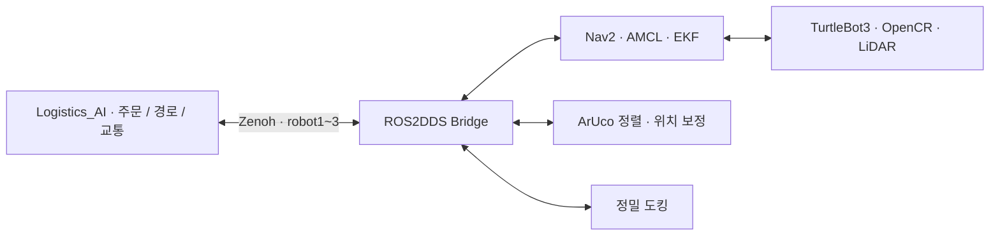

# Logistics_AMR

**LOGIFLOW · 주문 물품을 운반하고 작업 위치 정렬·충전 도킹을 수행하는 AMR**

TurtleBot3 Burger 3대의 로봇 측 ROS 2 작업공간이다. 센서와 구동부를 실행하고, FMS가 요청한 이동 경로를 Nav2로 수행한다. 작업 지점에서는 ArUco 마커·LiDAR 기반 정렬과 위치 보정을 사용하고, 복귀 후 정밀 도킹을 연결한다.

[개요](#1-프로젝트-개요) · [기능](#2-주요-기능) · [연결](#3-시스템-연결) · [환경](#4-실행-환경) · [구조](#5-저장소-구조) · [설치](#6-설치-및-환경-설정) · [사용](#7-사용-방법) · [운영](#8-설정과-운영-시-참고) · [점검](#9-확인-및-점검) · [문서](#10-관련-문서와-저장소) · [브랜치](#11-브랜치와-문서-기준)

## 1. 프로젝트 개요

상차·하차 장비 사이의 운반 구간을 자동화하는 저장소다. FMS는 어떤 로봇이 어떤 작업을 할지 관리하고, AMR은 실제 주행·센서 처리·정렬·도킹을 수행한다.

작업 위치까지 가는 것과 로봇팔이 작업할 수 있는 위치·방향에 정렬하는 것을 함께 다룬다. 로봇별 센서·초기 위치·마커 정렬·도킹 파라미터를 분리해 같은 작업 흐름을 3대에 적용한다.

## 2. 주요 기능

- **통합 Bringup:** 로봇 구동부, LiDAR, EKF, 위치 발행, Nav2, 정렬·도킹 액션 연결.
- **주행·위치 추정:** AMCL, 지도·keepout, 경유점 기반 주행과 Nav2 제어.
- **작업 위치 정렬:** ArUco 마커와 LiDAR를 이용한 정밀 정렬·자세 보정·AMCL 위치 보정.
- **정밀 도킹:** ICP 기반 스테이션 접근과 로봇별 도킹 파라미터.
- **도킹 후 출발:** 제어된 출발 동작을 위한 `/drive_on_heading` 액션 중계.
- **상태 송신:** 로봇 위치, 배터리, 지도·경로를 FMS에 전달.
- **환경별 통신:** 로봇 내부 ROS를 로컬로 유지하고 Zenoh로 `/robot1`~`/robot3`를 분리한다.

## 3. 시스템 연결



| 인터페이스 | 용도 |
|---|---|
| `/battery_state`, `/logitle_pose` | 배터리·실제 위치 송신 |
| `/map`, `/plan` | 지도·계획 경로 송신 |
| `/navigate_through_poses` | FMS 경유 경로 주행 요청 |
| `/aruco_align_and_correct` | 작업 위치 정렬·위치 보정 |
| `/precision_dock` | 정밀 도킹 |
| `/drive_on_heading` | 제어된 직진 출발 |
| `/cmd_vel` | FMS 수동 속도 제어 중계 |

표는 로봇 내부 이름이다. FMS에서는 `/robot1/...`, `/robot2/...`, `/robot3/...`로 구분한다. 실제 허용 목록은 [bridge.json5](src/zenoh_pkg/config/bridge.json5)가 기준이다. 도킹 접촉 센서의 MQTT 수신과 관제 표시 처리는 FMS 저장소의 역할이다.

## 4. 실행 환경

| 항목 | 구성 |
|---|---|
| 하드웨어 | TurtleBot3 Burger 3대, Raspberry Pi, OpenCR, LDS-02, ArUco용 카메라 |
| 운영체제·ROS | Ubuntu 24.04, ROS 2 Jazzy |
| 주행 | Nav2, AMCL, robot_localization EKF |
| 정렬·도킹 | OpenCV·ArUco, LiDAR·TF, ICP 도킹 |
| FMS 연결 | CycloneDDS + Zenoh ROS2DDS Bridge |
| 로봇 내부 통신 | Domain 0 / CycloneDDS / LOCALHOST |
| 외부 장비 ID | `robot1`, `robot2`, `robot3` |

일반 DDS 모드는 shellscript의 로봇별 Domain 30/31/32를 사용한다. FMS와 연결하는 아래 실행 예시는 로컬 ROS + Zenoh 방식이다. WAF의 Domain 11 구성과 혼용하지 않는다.

## 5. 저장소 구조

```text
Logistics_AMR/                         # 로봇 설치 예: ~/logitle_ws
├── src/logitle/
│   ├── logitle_bringup/               # 통합 Launch
│   ├── logitle_aruco_msgs/            # 정렬·위치 보정 액션 메시지
│   ├── logitle_aruco_tools/           # ArUco 정렬·보정
│   ├── logitle_docking/               # 도킹 서버·로봇별 설정
│   ├── logitle_ekf/                   # 센서 융합
│   └── logitle_pose/                  # 위치 발행
├── src/turtlebot3/                    # 구동부·Nav2·지도·파라미터
├── src/turtlebot3_my_msg/              # PrecisionDock 액션 타입
├── src/zenoh_pkg/                     # Bridge Launch·허용 목록
├── src/nav2_graph_waypoint_bt/        # 경유점 Behavior Tree
├── src/nav2_straight_first_planner/   # 경로 계획 플러그인
├── src/ld08_driver/                   # LDS-02 드라이버 서브모듈
├── src/tools/                        # 실험·위치 관리 도구
└── docs/ · experiment_data/ · notebooks/  # 실험 기록·분석
```

## 6. 설치 및 환경 설정

ROS 2 Jazzy, rosdep, colcon이 설치된 새 로봇 기준이다.

```bash
source /opt/ros/jazzy/setup.bash
git clone --branch dev --recurse-submodules \
  https://github.com/E1I6-Logistics/Logistics_AMR.git ~/logitle_ws
cd ~/logitle_ws
rosdep install --from-paths src --ignore-src -r -y
colcon build --symlink-install --executor sequential
source install/setup.bash
```

기존 작업공간에서는 로컬 변경을 확인한 뒤 `git pull --ff-only origin dev`, `git submodule update --init --recursive`로 갱신한다. `src/ld08_driver`의 고정된 드라이버 소스도 함께 받아야 한다.

로봇별 호스트명·계정·장치 포트와 카메라 보정 파일을 확인한다. 통합 Launch는 계정명 `$USER`의 마지막 숫자 1/2/3으로 초기 위치와 도킹 YAML을 선택한다. 호스트명에서 장비 ID를 정하는 셸 설정과 별개의 기준이다.

환경·단축 명령 등록은 [shellscript](https://github.com/E1I6-Logistics/shellscript/tree/dev)의 AMR 설치 절차를 사용한다. `zenoh-bridge-ros2dds` 바이너리와 하드웨어 설정까지 colcon 빌드가 모두 설치하는 것은 아니다.

## 7. 사용 방법

### 터미널 1: 로봇 통합 실행

```bash
source /opt/ros/jazzy/setup.bash
source ~/logitle_ws/install/setup.bash
export TURTLEBOT3_MODEL=burger LDS_MODEL=LDS-02
export ROS_DOMAIN_ID=0 RMW_IMPLEMENTATION=rmw_cyclonedds_cpp
export ROS_AUTOMATIC_DISCOVERY_RANGE=LOCALHOST
unset ROS_LOCALHOST_ONLY
ros2 launch logitle_bringup logitle_robot.launch.py
```

통합 Launch는 기본적으로 구동부·LiDAR·EKF·AMCL·Nav2·위치 발행·ArUco·도킹 서버를 실행한다. 카메라는 기본 상시 실행이 아니라 ArUco 작업 때 요청하는 구성이다.

### 터미널 2: FMS 연결

FMS PC에서 Router를 먼저 준비하고 로봇마다 ID를 맞춘다.

```bash
source /opt/ros/jazzy/setup.bash
source ~/logitle_ws/install/setup.bash
export ROS_DOMAIN_ID=0 RMW_IMPLEMENTATION=rmw_cyclonedds_cpp
export ROS_AUTOMATIC_DISCOVERY_RANGE=LOCALHOST
unset ROS_LOCALHOST_ONLY
ros2 launch zenoh_pkg zenoh.launch.py \
  robot_id:=robot1 router_ip:=192.168.0.16
```

`robot_id`는 해당 장비의 번호, `router_ip`는 실제 FMS PC IP다. `192.168.0.16`은 현장 예시다.

단축 명령이 등록된 장비는 각 터미널에서 `ros_local`, `sl`로 준비한 뒤 각각 `logibring`, `logizenoh`를 사용할 수 있다. 같은 노드를 수동·단축 명령으로 중복 실행하지 않는다.

### 선택 실행

| 목적 | Launch 인자 |
|---|---|
| Nav2 제외 | `use_nav2:=false` |
| ArUco 제외 | `use_aruco:=false` |
| 도킹 제외 | `use_docking:=false` |
| 도킹 설정 직접 지정 | `docking_params_file:=/절대경로/설정.yaml` |
| 전체 실행 인자 확인 | `ros2 launch logitle_bringup logitle_robot.launch.py --show-args` |

## 8. 설정과 운영 시 참고

- **로봇별 정렬값:** 최근 `dev`에는 N3/N4/N5/N6의 장비별 위치 보정이 포함된다. 공유 파라미터와 로봇별 오프셋을 함께 확인한다.
- **지도·좌표:** FMS의 그래프·지도와 로봇의 지도·초기 위치가 같은 좌표계를 사용해야 한다.
- **카메라·마커:** 영상 보정값·장착 TF·마커 ID와 작업 노드 매핑은 현장 자료다.
- **Nav2 설정:** `burger.yaml`의 Graph Waypoint BT, StraightFirst/ThetaStar, RPP, keepout·collision monitor 구성을 사용한다.
- **도킹 설정:** `docking_turtlebot1.yaml`~`docking_turtlebot3.yaml`을 구분한다. FMS의 접촉 검증 옵션과 로봇의 도킹 실행 결과도 따로 확인한다.
- **환경 변경:** 실행 중인 노드의 Domain·RMW는 새 터미널의 export만으로 바뀌지 않는다. 환경을 맞춘 뒤 해당 실행기를 다시 시작해야 한다.

## 9. 확인 및 점검

로봇의 ROS 환경에서 조회한다. 다음 명령은 이동을 요청하지 않는다.

```bash
ros2 node list
ros2 action list -t
ros2 topic list
ros2 lifecycle get /bt_navigator
```

| 증상 | 확인 위치 |
|---|---|
| FMS에서 로봇이 보이지 않음 | Router IP·7447 포트, robot ID, Bridge 로그 |
| 주행 준비 안 됨 | `/scan`, odom·TF, Nav2 lifecycle, 지도 로드 |
| 정렬 위치가 다름 | 계정 번호, 마커 ID, 카메라 보정·TF, 노드별 오프셋 |
| 도킹 실패 | 선택된 도킹 YAML, LiDAR·접근 위치·전원 상태 |
| 환경 설정이 다르게 표시됨 | 현재 셸의 Domain·RMW와 실제 노드 실행 환경 |

실험 절차와 결과는 `docs/`, `experiment_data/`, `notebooks/`에 남아 있다. 이번 문서·브랜치 정리에서는 로봇을 실행하거나 기존 실험 수치를 새 성능 결과로 갱신하지 않는다.

## 10. 관련 문서와 저장소

- [ArUco 정렬·위치 보정](src/logitle/logitle_aruco_tools/README.md)
- [Zenoh 패키지](src/zenoh_pkg/README.md)
- [경유점 BT](src/nav2_graph_waypoint_bt/README.md) · [경로 계획 플러그인](src/nav2_straight_first_planner/README.md)
- [실험 도구](src/tools/logitle_experiments/README.md) · [실험 계획](docs/00_navigation_accuracy_test_plan.md)
- [정리 전 설치·운영 안내](docs/README_REFERENCE.md)
- [FMS: Logistics_AI](https://github.com/E1I6-Logistics/Logistics_AI/tree/dev) · [환경·단축 명령: shellscript](https://github.com/E1I6-Logistics/shellscript/tree/dev)

기존 문서의 `Logistics_FMS` 경로·명칭은 작성 당시 기록이다. 현재 관제 저장소와 AX 프로젝트 경로는 `Logistics_AI` / `~/AX_Logistics`를 사용한다.

## 11. 브랜치와 문서 기준

2026-11-07 정리 기준은 원격 `dev`의 `bd0917d`다. AX에 이전에 고정된 버전보다 최신인 원격 `dev`를 기준으로 README를 맞춘다. **`main` 반영은 최종 검토·이미지 추가 후 별도로 진행한다.**

이번 정리에서 주행·도킹·마커·센서 코드와 지도·파라미터는 수정하지 않는다. 원격 개발 이력과 로컬의 이전 사용 이력도 삭제하지 않는다.
